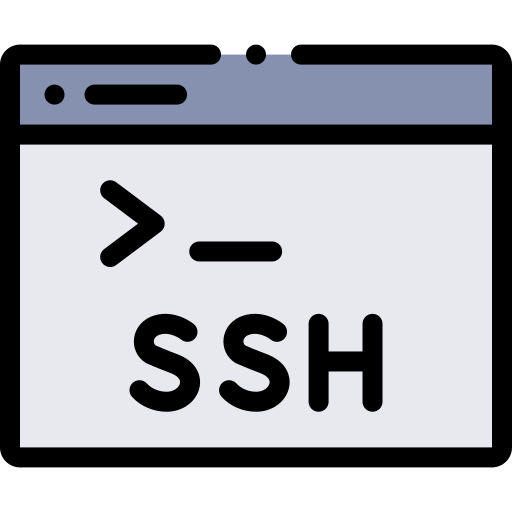
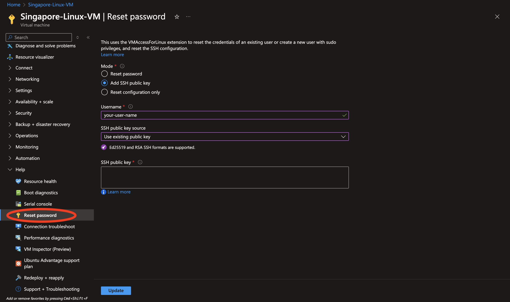
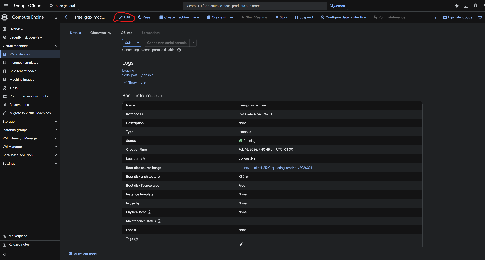
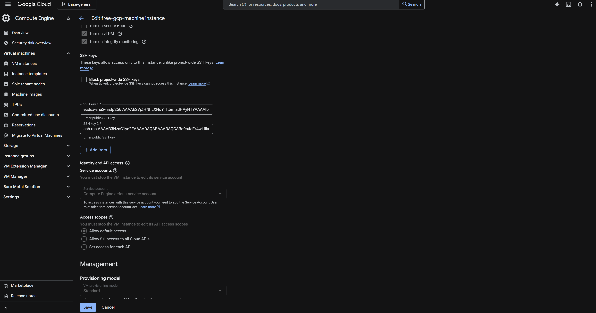

# SSH 客户端完全使用指南



## Before we beginning

当我们使用 SSH 连接到一台远程服务器的时候，需要输入 username、password 来进行登录。比如

但是这样子容易遇到一些安全问题，比如说一台 server（public ip）可能会遇到密码爆破攻击。出于安全考虑，我们通常会使用 SSH key。

## Connection Basics

一次 SSH 连接通常由下面几个部分组成：

- `User`：登录远程服务器时使用的 username
- `HostName`：远程服务器的 public ip、private ip 或 domain name
- `Port`：SSH server 监听的 port，默认是 `22`
- `Authentication`：认证方式，例如 password 或 SSH key

最基础的连接命令如下：

```shell
ssh <username>@<remote-server-ip>
```

如果 SSH server 使用的不是默认 22 号端口，则需要指定 port：

```shell
ssh -p <ssh-port> <username>@<remote-server-ip>
```

## Create A Key Pair

使用下面的命令生成 SSH key：

```bash
ssh-keygen -t rsa -b 4096 -C "note" -f ~/.ssh/<key-filename>
```

`-t`: type 指定算法 rsa

`-b`: bits 指定安全位数，rsa 建议至少 2048

`-C`: comments 注释

`-f`: file 指定输出文件名

这样就会生成 `~/.ssh/<key-filename>`（私钥） 和 `~/.ssh/<key-filename>.pub`（公钥）

生成过程中我们可以选择是否给私钥加 passphrase（密码短语）。如果加了，在登录时需要输入 passphrase 来解密私钥。

而我们写的注释（note），会记录在公钥文件的结尾处，可以直接打开 `.pub` 文件查看。

对于文件名，我们最好起一个有意义的名字，例如 `Singapore-Linux-VM-SSH-Key`。

e.g.

```shell
➜ .ssh  ssh-keygen -t rsa -b 4096 -C "Singapore Linux VM" -f ./Singapore_Linux_VM_SSH_Key
Generating public/private rsa key pair.
Enter passphrase (empty for no passphrase):
Enter same passphrase again:
Your identification has been saved in ./Singapore_Linux_VM_SSH_Key
Your public key has been saved in ./Singapore_Linux_VM_SSH_Key.pub
The key fingerprint is:
SHA256:lcVNmuQlFiyBm6FMZfzL+0uhLVWzftlGcURFXz/t5w8 Singapore Linux VM
The key's randomart image is:
+---[RSA 4096]----+
|       oo..+*+ooB|
|      ..+ .*o=..=|
|     o . =o.+ oo=|
|      o o..  . ++|
|        S. .o . +|
|          o+ o o+|
|          o.o E.=|
|          .o   +.|
|           .o.  .|
+----[SHA256]-----+
```

> [!note]
>
> 如果在 Windows PowerShell 环境中，这个命令会让你输入 2 次 passphrase 之后会失败并且报错：
>
> ```powershell
> Generating public/private rsa key pair.
> Enter passphrase (empty for no passphrase):
> Enter same passphrase again:
> Saving key "~/.ssh/github-ssh-key" failed: No such file or directory
> ```
>
> 这是因为在某些版本的 PowerShell 中 `~` 符号没有被 PowerShell 解析后再传递给命令。
>
> 例如 [Powershell does not expand '~' for external programs · Issue #20031 · PowerShell/PowerShell](https://github.com/PowerShell/PowerShell/issues/20031)

## Install The Public Key

既然已经生成了 SSH key，我们就需要将 public key 添加到 remote server 中去。

### Use ssh-copy-id

```shell
ssh-copy-id -p <ssh-port> -i ~/.ssh/Singapore_Linux_VM_SSH_Key.pub <username>@<remote-server-ip>
```

如果使用默认的 22 号端口，可以省略 `-p <ssh-port>` 参数。

e.g.

```shell
$ ssh-copy-id -p <ssh-port> -i ./Singapore_Linux_VM_SSH_Key.pub <username>@<remote-server-ip>
/usr/bin/ssh-copy-id: INFO: Source of key(s) to be installed: "./Singapore_Linux_VM_SSH_Key.pub"
/usr/bin/ssh-copy-id: INFO: attempting to log in with the new key(s), to filter out any that are already installed
/usr/bin/ssh-copy-id: INFO: 1 key(s) remain to be installed -- if you are prompted now it is to install the new keys
Plain@<remote-server-ip>'s password:

Number of key(s) added: 1

Now try logging into the machine, with:   "ssh -p <ssh-port> 'Plain@<remote-server-ip>'"
and check to make sure that only the key(s) you wanted were added.
```

> [!note]
>
> 在 Windows PowerShell 环境下无法使用 `ssh-copy-id` 命令，此时可以打开 Git Bash 去运行这个命令。

### Add authorized_keys Manually

如果命令的方式行不通，那么我们可以手动将 public key 添加到 server 上去。

先登录 server，打开 `~/.ssh/authorized_keys` 文件，将 `.pub` 结尾的内容复制进去。

### Add Key in Cloud VM Console

如果用的是 Azure Linux VM，可以在 Azure portal 中添加 SSH public key。



在 GCP 中则是需要进入 VM instance edit 这个位置：



进入 edit 之后往下滑动就能看见 SSH key。



## Connect With A Key

如果我们直接用 `ssh username@remote-server-ip`，SSH 默认会仅尝试 `id_rsa` 这样默认命名的密钥。

所以我们需要在命令行指定：

```shell
ssh -i ~/.ssh/id_rsa_remote_server username@remote-server-ip
```

当然为了方便起见，我们往往在 `~/.ssh/config` 中添加配置，让 SSH 自动知道该请求要用哪个 key。

## SSH Config

SSH client 可以通过 `~/.ssh/config` 保存连接参数。这样我们就不需要每次输入一系列复杂的参数，而是给这些连接参数起一个名字（ host entry ），然后用 `ssh <Host>` 快速登录。

### Basic Host Entry

最小配置示例：

```sshconfig
Host remote-server
    HostName remote-server-ip
    User username
    IdentityFile ~/.ssh/id_rsa_remote_server
```

这个配置的意思是：当执行 `ssh remote-server` 时，SSH client 会自动使用这里指定的 host、user 和 key。

### Option Reference

实际使用时，一个 host entry 可能还会包含 port、agent、key selection、keepalive 等配置。

一个更完整的配置如下：

```sshconfig
Host <name>
    HostName <public-ip/private-ip>
    User <username>
    Port <ssh-port>
    IdentityFile ~/.ssh/id_rsa
    AddKeysToAgent yes
    IdentitiesOnly yes
    ServerAliveInterval 20
    ServerAliveCountMax 6
    TCPKeepAlive yes
    IPQoS none
```

1. `IdentityFile ~/.ssh/id_rsa`

   请优先尝试这个 key。

2. `AddKeysToAgent yes`

   SSH client 在验证成功后，自动把解密后的密钥存入 ssh-agent（如果 ssh-agent 没有启动，则不会生效）。

   如果没有这一条，那么 ssh-agent 是不会在你 SSH 连接服务器的时候自动获得你的密钥的，也就是说需要你手动 `ssh-add` 那个 key。

3. `IdentitiesOnly yes`

   连接时，只用 `~/.ssh/id_rsa` 这把 key 做公钥认证；不再额外尝试其他的 key。

4. `ServerAliveInterval 20`

   SSH 客户端每 20 秒给服务器发一次应用层心跳包，防止链路被当成“空闲连接”而回收。

5. `ServerAliveCountMax 6`

   连续 6 次心跳没收到回复，SSH client 才断开连接，防止网络抖动时立刻断。

6. `TCPKeepAlive yes`

   启用操作系统 TCP 层 keepalive。

7. `IPQoS none`

   不设置 SSH 流量的 DSCP/QoS 标记。绕过某些网络设备对特定 QoS 标记处理不当导致的掉线/限速。

> [!tip]
>
> 在 VS Code 的 Remote-SSH 插件中使用 `Remote-SSH: Open SSH Configuration File...` 同样编辑的就是这个文件。
>
> 改完 `~/.ssh/config` 对新的 SSH 连接会立刻生效，不需要重启 Windows，也通常不需要重启 ssh-agent。

## SSH Agent

如果我们的 ssh key 设置了密码，那么我们每次连接的时候都需要输入，为了更加方便，我们可以使用 ssh agent 存储解密后的私钥（在内存中缓存已解密的私钥），使得只需要输入一次 passphrase，就可以在会话期间重复使用。

### Windows

查看 ssh-agent 服务：

```powershell
Get-Service ssh-agent
```

启动服务：

```powershell
Start-Service ssh-agent
```

设置为自动启动：

```powershell
Set-Service -Name ssh-agent -StartupType Automatic
```

添加 SSH key 到 ssh-agent：

```powershell
ssh-add C:\Users\<username>\.ssh\github-ssh-key
```

查看已经添加的 SSH key：

```powershell
ssh-add -l
```

### Linux/Mac

首先查看 ssh-agent 是否已经启动：

```shell
echo $SSH_AGENT_PID
```

如果 `ssh-agent` 运行中，会显示其进程 ID（PID）；如果没有运行，则输出为空。

如果显示为空，那么使用下面的命令启动 ssh-agent：

```bash
eval "$(ssh-agent -s)"
```

添加 SSH 私钥：

```bash
ssh-add ~/.ssh/<ssh-key-filename>
```

### Persistence

为了实现 ssh-agent 持久化，可以将这些命令添加到 shell 配置文件中。

对于 Bash（`~/.bashrc` 或 `~/.bash_profile`）：

```bash
if [ -z "$SSH_AUTH_SOCK" ] ; then
    eval "$(ssh-agent -s)"
fi
```

保存文件后，重新加载配置：

```bash
source ~/.bashrc  # 如果使用 bash
```

这样设置后，每次打开新的终端会话时，ssh-agent 都会自动启动，并且会添加你的 SSH 密钥。

## SSH Agent For AI Coding Agents

在使用 Codex 这类 coding agent 的时候，SSH Agent 会遇到一个额外的问题：coding agent 执行 `ssh` 或 `git push` 的进程，不一定和我们手动操作的 terminal 是同一个 shell session。

如果 SSH private key 设置了 passphrase，那么普通 terminal 可以在第一次使用时输入 passphrase，然后把解密后的 key 加入 ssh-agent。但是 coding agent 通常不能在命令执行过程中让我们输入 passphrase；如果它也看不到当前 session 的 `SSH_AUTH_SOCK`，就无法复用已经解锁的 key。

一个直接但不太理想的做法是给 private key 去掉 passphrase。这样 coding agent 可以直接使用这个 key，但风险是：只要 private key 文件被读取，就可以被直接拿去使用。

更好的做法是：让 coding agent 使用 ssh-agent，而不是直接持有没有 passphrase 的 private key。

### The Core Idea

`SSH_AUTH_SOCK` 指向的是 ssh-agent 的 socket。这个 socket 不是用来存放解密后的 key 的文件，而是通往 ssh-agent 进程的入口。

真正解密后的 private key 存在 ssh-agent 进程的内存里。其他程序通过 socket 请求 ssh-agent 帮它完成签名，但不会直接读取 private key 本身。

所以这里的授权模型是：

```text
private key file + passphrase -> ssh-agent process -> agent socket -> ssh/git/coding agent
```

也就是说，我们可以让 coding agent 访问 agent socket，让它在当前授权窗口内使用 key；当 key 从 agent 中移除、agent 退出、或者 socket 不再暴露时，coding agent 就不能继续使用这个 key。

### Fixed Agent Socket

在普通 terminal 中，`SSH_AUTH_SOCK` 通常会指向当前 shell session 里的 agent socket。但是在 VS Code Remote-SSH、GUI app、extension host、task runner 这类场景下，不同进程不一定共享同一个 shell session。

因此只依赖 `SSH_AUTH_SOCK` 的环境变量继承并不稳定。更稳的方式是使用一个固定路径的 agent socket，例如：

```text
~/.ssh/agent.sock
```

然后让 ssh-agent 监听这个 socket：

```bash
export SSH_AUTH_SOCK="$HOME/.ssh/agent.sock"

ssh-add -l >/dev/null 2>&1
if [ "$?" = 2 ]; then
    rm -f "$SSH_AUTH_SOCK"
    eval "$(ssh-agent -a "$SSH_AUTH_SOCK" -s)" >/dev/null
fi
```

如果希望每次打开 terminal 都自动使用这个固定 socket，可以把这段放到 `~/.bashrc` 或对应 shell 的配置文件中。

### IdentityAgent

除了在 shell 中设置 `SSH_AUTH_SOCK`，还可以在 `~/.ssh/config` 里使用 `IdentityAgent`，让 OpenSSH 固定使用某个 agent socket。

例如：

```sshconfig
Host github.com
    HostName github.com
    User git
    IdentityFile ~/.ssh/github-key
    IdentityAgent ~/.ssh/agent.sock
    AddKeysToAgent yes
```

这样做之后，即使 coding agent 不是从当前 terminal 启动的，只要它执行的是普通 `ssh` 或 `git push`，OpenSSH 也会根据 `IdentityAgent ~/.ssh/agent.sock` 找到同一个 ssh-agent。

`AddKeysToAgent yes` 的作用是：当这把 key 被成功使用后，SSH client 会尝试把解密后的 key 加入 agent。前提是 agent 已经存在，并且 SSH client 能找到它。

### Temporary Authorization

如果我们希望 key 只在一段时间内可用，可以使用 `ssh-add -t`：

```bash
ssh-add -t 1h ~/.ssh/<key-filename>
```

这表示把 key 加入 agent，但只保留 1 小时。

也可以在不需要的时候手动移除：

```bash
ssh-add -d ~/.ssh/<key-filename>
```

或者清空当前 agent 中的所有 key：

```bash
ssh-add -D
```

这种方式比较适合 coding agent：我们仍然给 private key 设置 passphrase，但在需要的时候临时把 key 加进 ssh-agent。coding agent 可以在这个授权窗口内使用 key，窗口结束后就不能继续使用。

### VS Code Remote-SSH

在 VS Code Remote-SSH 场景中，VS Code 会在 remote machine 上启动 VS Code Server，extension 也可能运行在 remote machine 上。这个 extension host 和 integrated terminal 在同一台机器上，但不一定是同一个 shell session。

所以如果只是在 integrated terminal 里临时 `export SSH_AUTH_SOCK=...`，Codex extension 不一定能看到这个变量。

更稳定的做法是：

1. 在 remote machine 上使用固定 socket，例如 `~/.ssh/agent.sock`
2. 在 `~/.ssh/config` 里通过 `IdentityAgent ~/.ssh/agent.sock` 指向它
3. 在需要授权时，手动 `ssh-add -t 1h ~/.ssh/<key-filename>`

这样即使 coding agent 和 terminal 不是同一个 session，它们执行 `ssh` 或 `git push` 时也会通过同一个 agent socket。

### Security Notes

使用 agent socket 比直接给 coding agent 一把没有 passphrase 的 private key 更安全，因为 private key 本身不会被交给 coding agent。

但要注意：只要某个进程可以访问 agent socket，它就可以在当前授权窗口内请求 ssh-agent 使用里面的 key。因此这个方案解决的是“不要暴露 private key”和“授权可以过期或撤销”，不是“每一次 SSH 使用都单独确认”。

如果希望每次使用 key 都需要确认，可以了解 `ssh-add -c` 或使用 1Password SSH Agent 这类带确认机制的 agent。
